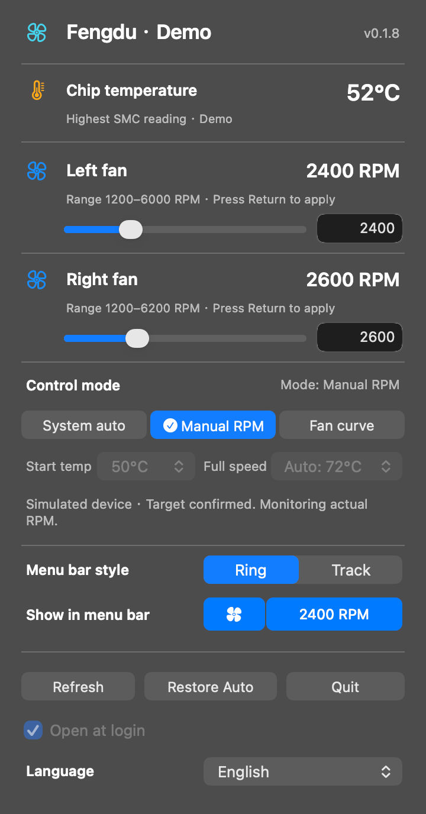

# Fengdu

When your Mac’s fans spin up, open the menu bar to see chip temperature and actual RPM. Enter a target speed for each fan, set a temperature curve, or hand control back to your Mac.

**[Download Fengdu 0.1.8](https://github.com/ZhaoOyu/fengdu/releases/download/v0.1.8/Fengdu-0.1.8-macos-arm64.dmg)** · [简体中文](README.md)

For Apple Silicon Macs with built-in fans, running macOS 14 or later.

The menu bar shows AUTO during automatic control or your target RPM in manual mode. The outline shows the first fan’s target as a fraction of its maximum. Click the previews to show the fan icon, the reading or both.

| Mode | When to use it |
| --- | --- |
| System auto | Let macOS manage cooling while you monitor temperature and fan speeds. |
| Manual RPM | Drag a slider or type a target within the displayed range and press Return. |
| Fan curve | Pick the temperatures at which fans start ramping up and reach full speed. At 90°C, or if the temperature reading is lost, Fengdu requests a return to system control. |

## Get started

Open the DMG, drag Fengdu into Applications and launch it. Monitoring requires no administrator approval. macOS asks for authorization when you first apply a manual speed or curve. Enable **Open at login** to keep fan readings in the menu bar after signing in.

Fanless Macs have no fan speed to adjust. If another utility is controlling the fans, restore automatic control there before clicking Refresh in Fengdu.

[Release notes](https://github.com/ZhaoOyu/fengdu/releases/tag/v0.1.8) · [Report an issue](https://github.com/ZhaoOyu/fengdu/issues)

The interface follows your system language by default. Open **Language** at the bottom of the panel to switch to **简体中文** or **English**.
