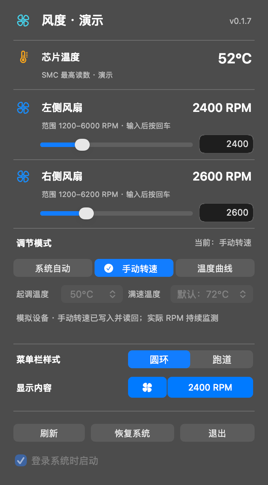

# 风度

风扇响起来时，点开 Mac 菜单栏就能看到芯片温度和实际转速。想固定转速就输入 RPM，希望随温度变化就设一条曲线，用完点「恢复系统」。

**[下载风度 0.1.7](https://github.com/ZhaoOyu/fengdu/releases/download/v0.1.7/Fengdu-0.1.7-macos-arm64.dmg)** · 适用于 macOS 14 及以上、有内置风扇的 Apple Silicon Mac

自动调节时显示 AUTO。手动模式显示目标转速，图中跑道亮了一半，表示目标为风扇最高转速的一半。

## 三种调节方式

| 想怎么用 | 在风度里怎么做 |
| --- | --- |
| 让 Mac 自己管理散热 | 保持「系统自动」。打开面板就能查看芯片温度和每个风扇的实际转速。 |
| 让风扇维持指定转速 | 点「手动转速」，拖动滑块，或输入目标 RPM 后按回车。面板会显示这台 Mac 允许的范围。 |
| 随温度升高逐步加速 | 点「温度曲线」，选择开始提速和达到满速的温度。若芯片达到 90°C 或温度读数失效，风度会请求交回系统控制。 |

菜单栏可选**圆环或跑道**。亮起的长度表示第一个风扇的目标转速占上限的比例。点击风扇和数字预览，可以只留图标、只留读数，或同时显示。手动模式显示目标 RPM，自动调节时显示 AUTO。

## 安装与启用

打开下载的 DMG，将 Fengdu 拖入「应用程序」并启动。只查看温度和转速无需授权，首次启用手动或温度曲线时，macOS 会请求管理员授权。希望每次登录都能看到风扇状态，可以勾选「登录系统时启动」。

无风扇的 MacBook Air 无法调速。若面板提示「外部手动控制」，先在原来的风扇工具中恢复自动，再回到风度点击「刷新」。

[版本与校验文件](https://github.com/ZhaoOyu/fengdu/releases/tag/v0.1.7) · [反馈机型或使用问题](https://github.com/ZhaoOyu/fengdu/issues)
