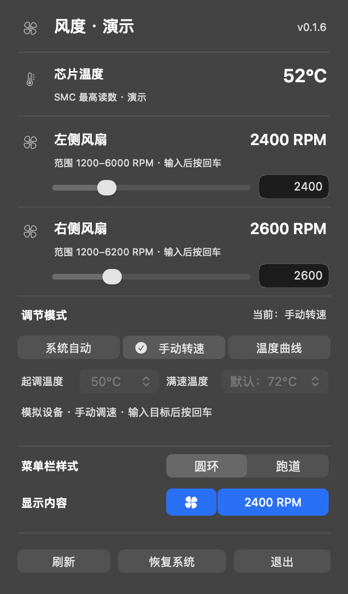

# 风度 · Fengdu

**想让 Mac 提早散热，不必一直盯着温度。** 在菜单栏里点开风度，输入一个目标转速，或画出自己的散热节奏：从多少度开始提速，到多少度达到满速。想交回给 Mac，点一下「系统自动」即可。

**[下载 Mac 安装包（DMG）](https://github.com/ZhaoOyu/fengdu/releases/latest) · [查看版本更新](https://github.com/ZhaoOyu/fengdu/releases) · [反馈问题](https://github.com/ZhaoOyu/fengdu/issues)**

适用于 **macOS 14 或更新版本、有内置风扇的 Apple Silicon Mac**。不同机型的风扇控制支持取决于硬件；无风扇的 MacBook Air 无法调速。安装包无需 Homebrew 或额外的风扇工具。

**0.1.7 新增登录自启。** 勾选「登录系统时启动」，下次登录就能在菜单栏看到风扇状态。面板用橙色温度计和蓝色风扇区分温度与转速，切换圆环和跑道时图标与文字保持同样大小。

## 菜单栏，留给你想看的内容

| 想看到什么 | 怎么设置 |
| --- | --- |
| 目标转速占上限的多少 | 选择**圆环**或**跑道**。亮起半圈，表示第一个风扇的目标转速是它上限的一半。 |
| 只看数字、只看风扇，或两者都看 | 点击「显示内容」里的两个预览，高亮的部分会出现在菜单栏，至少保留一项。 |
| 风扇此刻实际转得多快 | 点开面板查看每个风扇的实际 RPM。菜单栏手动模式显示已确认的**目标 RPM**；系统自动和温度曲线显示 **AUTO**。 |

## 选一种调节方式，点击即应用

- **系统自动**：由 Mac 决定转速。首次打开只读取状态，无需管理员权限。
- **手动转速**：为每个风扇拖动滑块并松开，或输入 RPM 后按回车。无需等温度升高；目标必须在面板标出的范围内，不能设为停转。
- **温度曲线**：设置起调温度和满速温度，风度每两秒按温度调节。默认满速温度取启用时的芯片温度加 20°C；你也可以自己指定。若读数达到 90°C、温度不可读或系统热压力过高，会请求交回系统自动，即使设定的满速温度更高。

*截图使用模拟风扇。打开应用后，面板显示本机读数。*

## 安装与首次使用

1. 从[发布页](https://github.com/ZhaoOyu/fengdu/releases/latest)下载名称以 `macos-arm64.dmg` 结尾的文件，打开并把 **Fengdu.app** 拖入「应用程序」。
2. 打开风度，点击菜单栏的风扇图标。安装包尚未经过 Apple 公证；若 macOS 拦截，可先对照发布页的 `SHA256SUMS.txt` 核验下载，再到「系统设置 → 隐私与安全性」允许打开。
3. 第一次切到手动或温度曲线时，macOS 会请求管理员授权以调节硬件。辅助工具已随应用提供，不安装常驻系统服务。
4. 需要开机自启时，勾选「登录系统时启动」。下次登录后风度会安静地出现在菜单栏，风扇由系统管理。
5. 用完后点「恢复系统」。风度正常退出、收到休眠通知或控制连接超时时，也会请求恢复系统控制。

**提示「外部手动控制」？** 先在原来的风扇工具里恢复自动并退出，再回风度刷新。风度不会接管另一款工具正在控制的风扇。

**为什么目标与实际转速不同？** 风扇加减速需要时间。目标是已写入并读回的设定，实际值来自硬件。手动模式会维持你设定的目标，不会根据温度替你提速；希望转速随负载变化时请用系统自动或温度曲线。

**兼容性：** 已在一台 Apple Silicon 单风扇 Mac 上验证手动写入、实际升速和交回系统。其他机型、休眠恢复和 Intel Mac 的实机表现尚未验证。风度使用非公开硬件接口；若系统崩溃或控制进程被强制终止，应用无法保证完成恢复。

[构建与测试](docs/DEVELOPMENT.md) · [MIT 许可证](LICENSE) · [第三方声明](THIRD_PARTY_NOTICES.md)
